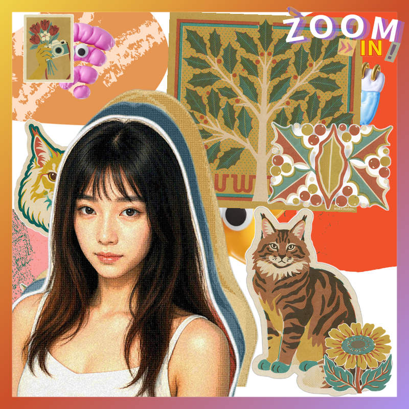
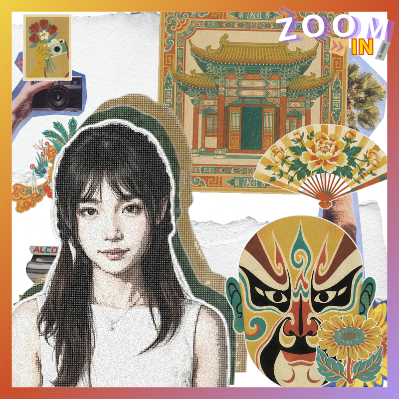
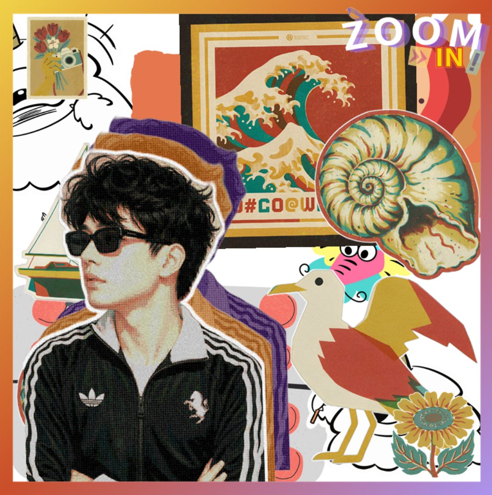
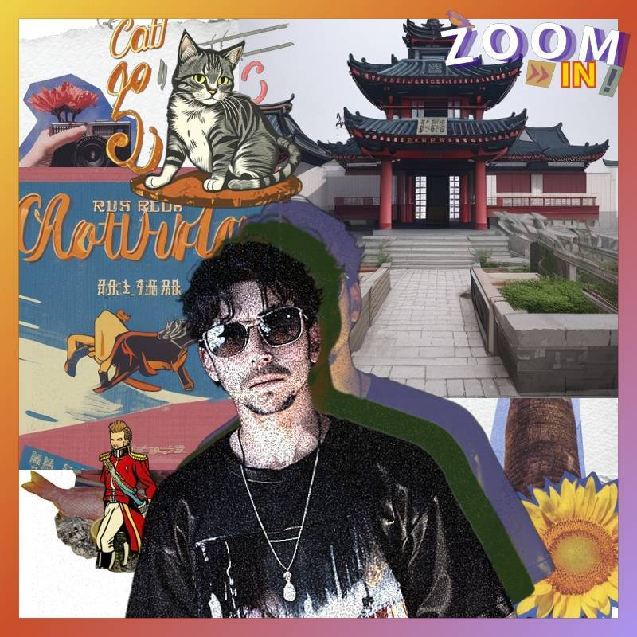
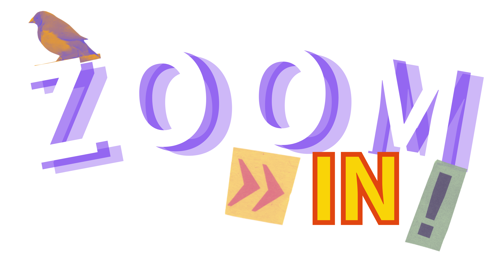

# ZOOM IN! 认知拼贴海报 · Collage Poster Skill

把一张正面人像变成复古拼贴风海报：人像自动抠图 → 青黄鲜三色错位叠印 → 与元素素材按固定版式合成 → 加渐变边框和 ZOOM IN! 标志。

Turn a portrait photo into a retro riso-style collage poster: auto cutout → 3-color offset misprint → fixed 8-layer layout → gradient frame + ZOOM IN! logo.

## 示例效果 · Examples

| 缅因猫 × 冬青（可爱） | 戏台 · 脸谱 · 凤冠（复古） |
|---|---|
|  |  |
| **冲浪里 × 海鸥（可爱）** | **照片直贴拼贴（原版风格）** |
|  |  |

> 元素素材：冬青树 / 缅因猫 / 京剧脸谱 / 凤冠盔头 / 牡丹折扇 / 戏台 —— 均按 `references/element-prompts.md` 的固定提示词骨架生成。



## 用法 · Usage

```
zoomin-collage-poster/
├── SKILL.md                  ← 完整说明（中英双语提示词模板 / 路径 / 踩坑记录）
├── scripts/generate.py       ← 核心管线（抠图/错位滤镜/8 层合成）
├── assets/
│   ├── base/                 ← 4 套 800×800 底图：cute / retro / funny / cool
│   ├── frame/frame.png       ← 彩虹渐变边框
│   └── logo/zoomin_logo.png  ← ZOOM IN! 标志
└── references/
    ├── style-guide.md        ← 完整视觉风格规则 + 人像生图提示词模板
    └── element-prompts.md    ← 元素素材固定提示词骨架（E1-E4）
```

### 三步出图

1. 准备一张正面人像
2. 备 4 张元素素材（E1 背景主块 / E2 前景点缀 / E3 道具左上 / E4 道具右中），或按 `references/element-prompts.md` 的固定骨架生成
3. 跑一条命令：

```bash
python scripts/generate.py --style 复古 --portrait input/selfie.jpg \
    --elements e1.png e2.png e3.png e4.png --out poster.png
```

风格：`可爱` / `复古` / `搞怪` / `酷帅`（cute / retro / funny / cool）。

## 环境依赖

```bash
pip install pillow   # 必需
pip install rembg    # 抠图后端（推荐，首次运行自动下模型）
```

人像默认先做「双图参考风格化」（AI 生图端，模板见 SKILL.md），产物再进本地管线；不装 rembg 也能跑（矩形直贴）。

## 签名效果

每种风格一套错位叠印参数（来自原作业滤镜脚本 1.0x 原参数）：

| 风格 | 滤镜层 | 偏移 |
|---|---|---|
| 可爱 | 鲜艳 + 青 0.3 / 黄 0.3 | 黄(10,-20) → 青(-10,0) → 本体(-30,20) |
| 复古 | vintage(饱和0.5) + 深墨绿 / 黄 | 同上 |
| 搞怪 | weird(暗0.67) + 橙 0.3 / 紫 0.5 | 同上 |
| 酷帅 | 赛博(饱和0.2) + 青 0.3 / 粉 0.3 | 粉(0,20) → 青(-60,20) → 本体(-30,20) |

滤镜层 duotone 双色调坍缩 + 按风格分派的印刷化后处理（posterize / halftone / grain），输出锁定 800×800。
